# Engranajes y Reductores — Guía de estudio

Aplicación web de una sola página (sin build, sin dependencias externas) para estudiar el
**Módulo 03 — Engranajes y reductores** de Elementos de Máquinas (ITU – UNCuyo).

Incluye toda la teoría de la cátedra, las fórmulas, los 4 bloques del TP de engranajes y los
7 problemas del práctico de reductores resueltos paso a paso, un cuestionario de 78 preguntas,
preguntas de desarrollo y un resumen imprimible en blanco y negro.

---

## Cómo verla

### En la computadora

Abrí `index.html` con doble clic y listo: funciona sin servidor (las fórmulas y las fuentes
matemáticas se cargan de la propia carpeta `assets/`). Si preferís servirla por HTTP:

```bash
cd App-Engranajes
python -m http.server 8000
```

y entrá a <http://localhost:8000>.

### En GitHub Pages (para el celular)

1. Creá un repositorio en GitHub (puede ser público).
2. Subí **el contenido de esta carpeta** (no la carpeta): `index.html`, `assets/` y este `README.md`.
3. En el repo: **Settings → Pages → Source: Deploy from a branch → Branch: `main` / carpeta `/ (root)`**.
4. Esperá un minuto y abrí `https://TU-USUARIO.github.io/TU-REPO/`.

Si preferís subir la carpeta tal cual, la URL será
`https://TU-USUARIO.github.io/TU-REPO/App-Engranajes/`.

> No hace falta Node, ni build, ni instalar nada. Es HTML + CSS + JavaScript planos.

---

## Vista previa

| Pantalla principal | Cuestionario |
|---|---|
| 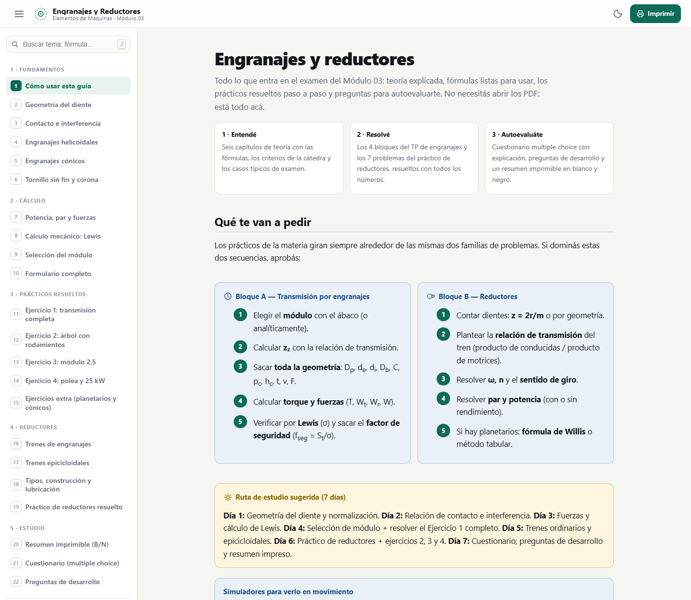 | 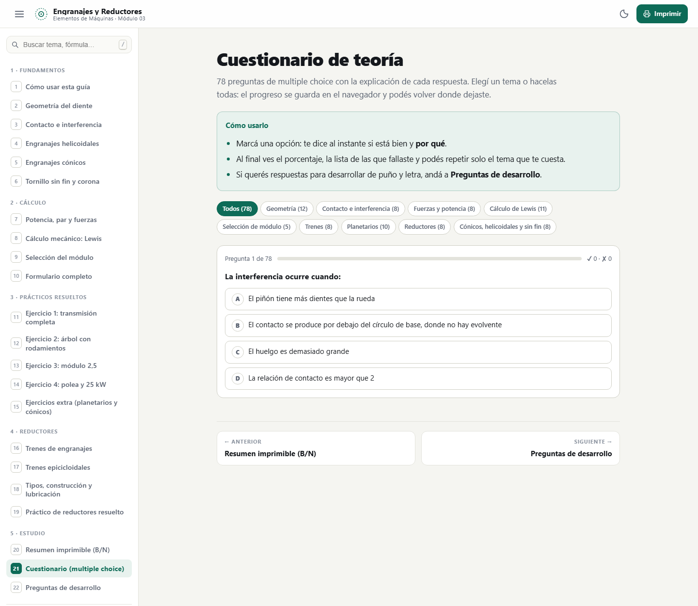 |

| Simulador del planetario (4 modos) |
|---|
| 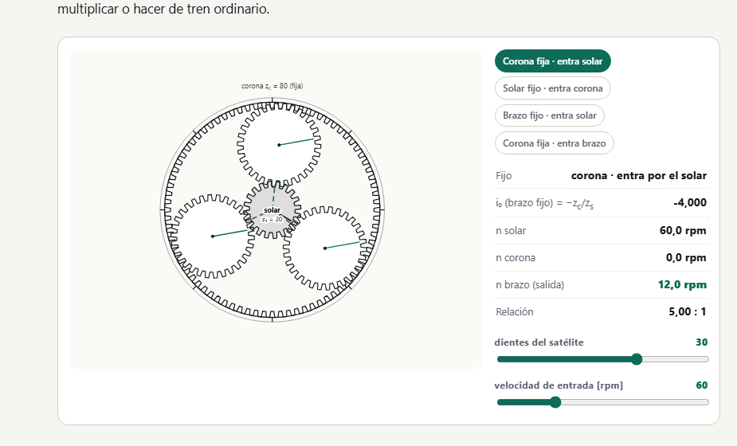 |

| Escena 3D: el reductor del práctico con el sentido de giro de cada rueda |
|---|
| 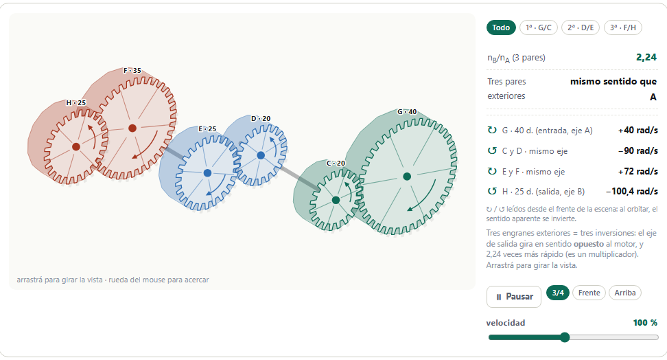 |

| Escena 3D: la cadena del práctico 2 (poleas → cónicos → cilíndricos → sin fin) |
|---|
| 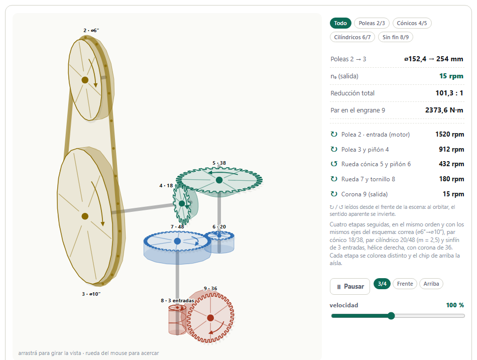 |

| Bloque de fórmulas que no son triángulo (Chuletas) |
|---|
| 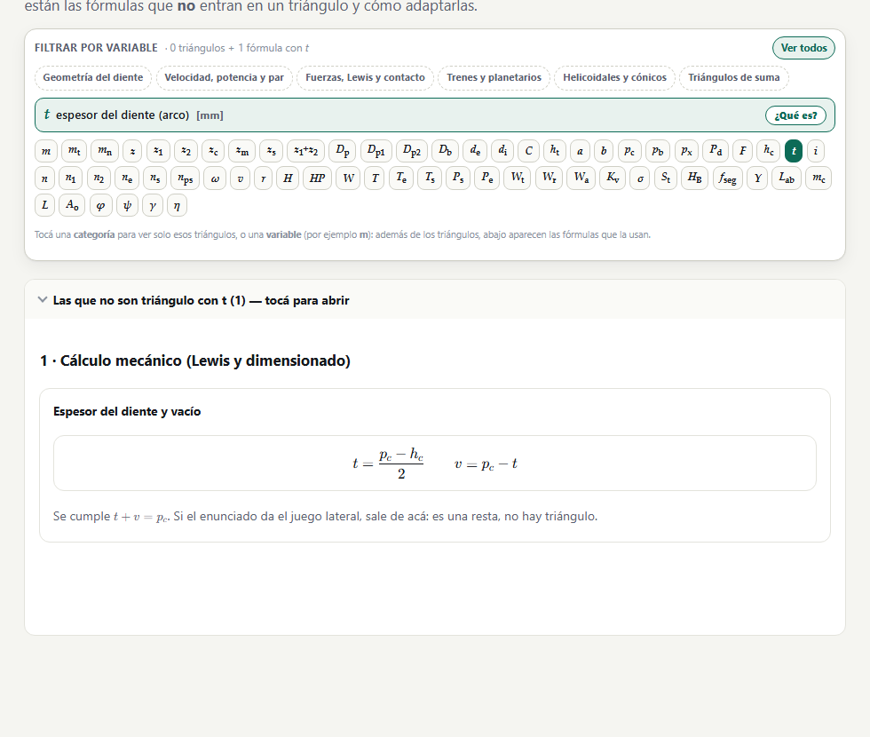 |

| Versión condensada: un triángulo por familia y las otras fórmulas de esa misma incógnita (2 páginas) |
|---|
| 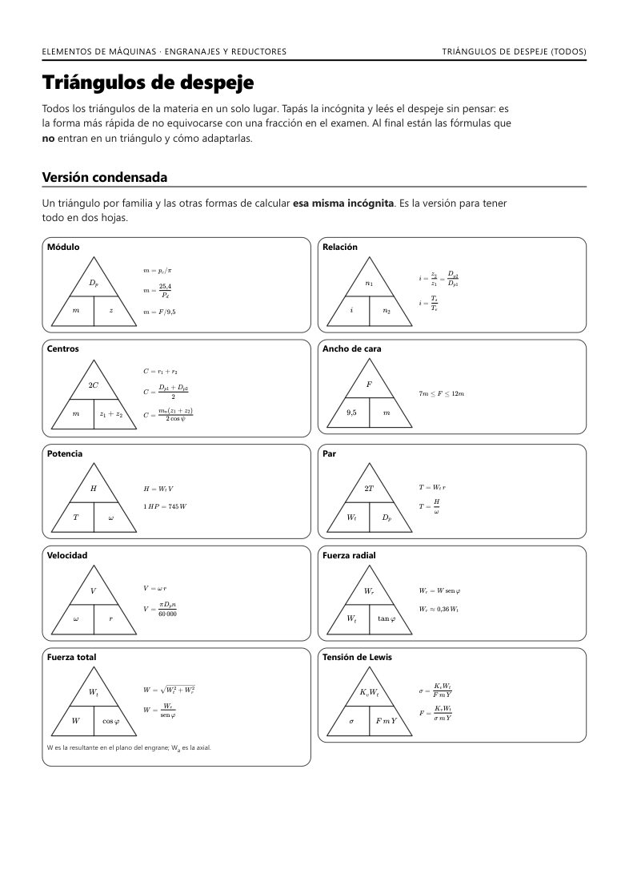 |

| Versión condensada en pantalla: el triángulo arriba y las otras formas en un panel debajo |
|---|
| 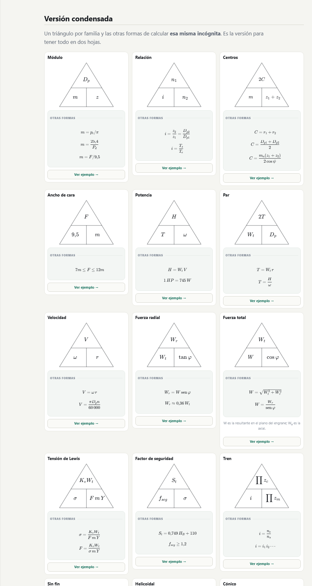 |

| Exámenes resueltos: tres exámenes de la cátedra con la resolución paso a paso |
|---|
| 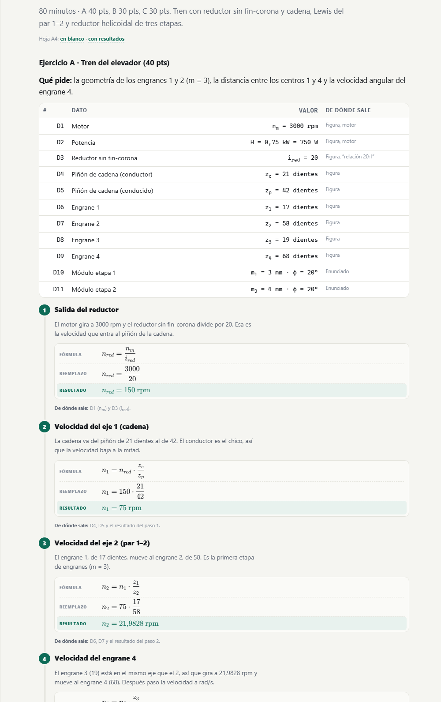 |

| Hojas de examen A4: el examen digitalizado, en blanco y con los resultados colocados |
|---|
| 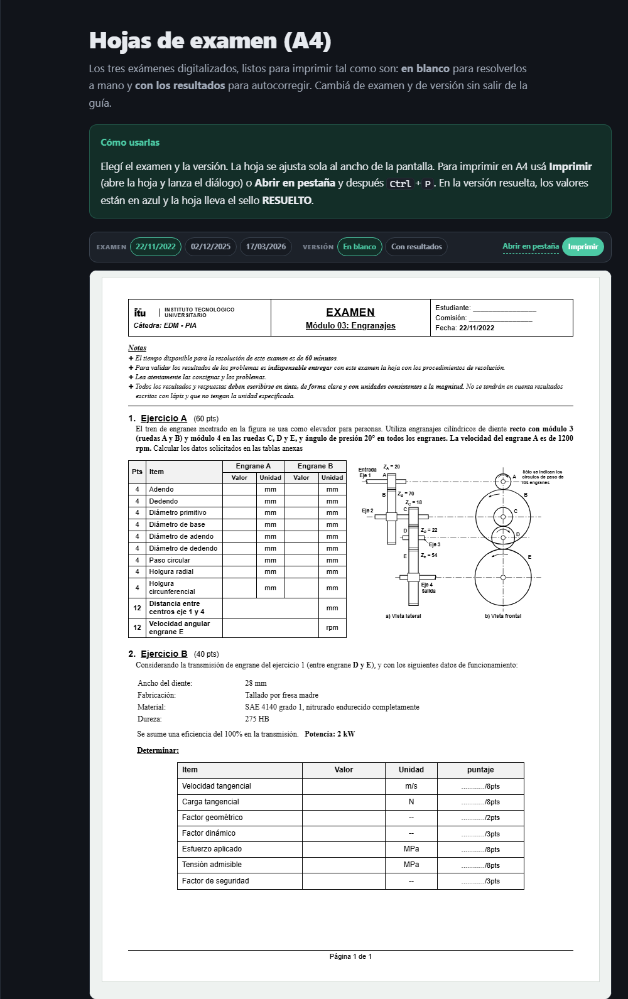 |

| Resumen impreso en A4 (blanco y negro) |
|---|
| 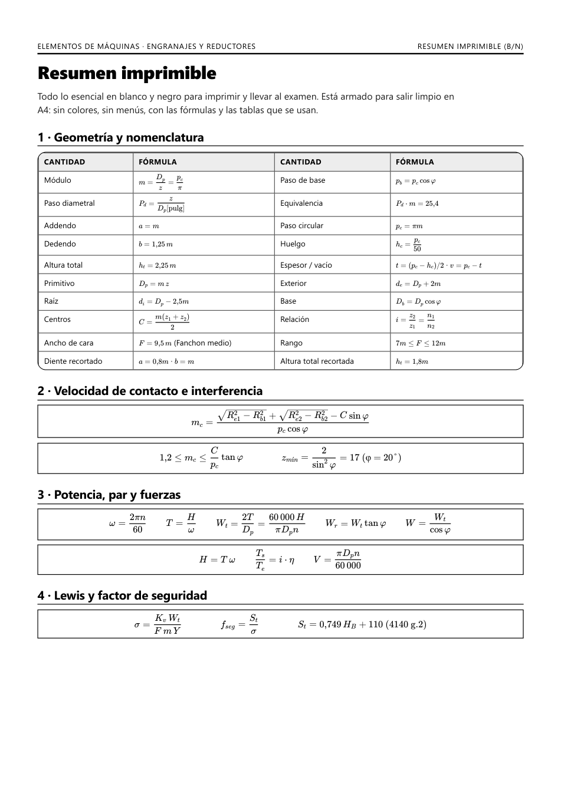 |

---

## Qué tiene adentro

| Grupo | Capítulos |
|---|---|
| **1 · Fundamentos** | Cómo usar la guía · Geometría del diente · Contacto e interferencia · Engranajes helicoidales · Engranajes cónicos · Tornillo sin fin y corona |
| **2 · Cálculo** | Potencia, par y fuerzas · Cálculo mecánico (Lewis + AGMA) · Selección del módulo · Formulario completo |
| **3 · Prácticos resueltos** | Ejercicio 1 (transmisión completa, 25 preguntas) · Ejercicio 2 (árbol con rodamientos) · Ejercicio 3 (módulo 2,5) · Ejercicio 4 (polea y 25 kW) · Ejercicios extra (planetarios y cónicos) |
| **4 · Reductores** | Trenes de engranajes · Trenes epicicloidales · Tipos, construcción y lubricación · Práctico de reductores resuelto (7 problemas) |
| **5 · Estudio** | Resumen imprimible (B/N) · Cuestionario (78 preguntas) · Preguntas de desarrollo (29) |
| **6 · Chuletas** | Triángulos de despeje: los 38 triángulos de la materia, con las tres lecturas de cada uno |
| **7 · Exámenes resueltos** | 02/12/2025 (Comisión B) · 22/11/2022 · Recuperatorio 17/03/2026 (Comisión B), con la resolución completa paso a paso · **Hojas de examen A4** (en blanco y con resultados) |

### Funciones

- **Fórmulas en notación matemática real** (fracciones con línea, raíces, subíndices) con KaTeX
  incluido localmente: no depende de internet.
- **Simuladores animados** (en PC y celular, a cámara lenta y con escala):
  - partes del diente interactivas (tocá cada parte y te la explica);
  - dos engranajes engranando con la línea de acción, el ángulo de presión, el punto de contacto y una regla de 50 mm;
  - **relación de contacto**: cambiás los dientes o el módulo y ves el tramo A–B sobre la línea de acción y el valor de m<sub>c</sub>;
  - tren compuesto de dos etapas con las velocidades y el sentido de giro de cada eje;
  - **planetario con sus cuatro modos** (corona fija, solar fijo, brazo fijo y entrada por el brazo),
    resolviendo Willis en vivo.
- **Escenas 3D interactivas** (sin librerías, con arrastre para orbitar, zoom con la rueda y
  dientes dibujados de verdad):
  - **las siete transmisiones del práctico de reductores**, cada una en su problema:
    1. reductor de ejes fijos m = 4 (6 ruedas / 4 ejes) — problema 1;
    2. cadena **poleas → cónicos → cilíndricos → sin fin** con la correa animada, con la misma
       disposición del esquema (correa vertical entre ⌀6″ y ⌀10″, el piñón 4 en el eje de la polea 3,
       5 y 6 sobre el eje vertical, el 7 bajando al sinfín y la corona 9 con eje horizontal) — problema 2;
    3. reductor de ejes fijos m = 3 — problema 3;
    4. reductor **helicoidal de 3 etapas** con el dentado inclinado — problema 4;
    5. planetario de **doble satélite** con el sol 2 fijo — problema 5;
    6. planetario con el **engrane 6 fijo** (multiplicador 24,5:1) — problema 6;
    7. tren con **corona interior fija** y dos satélites en serie — problema 7;
  - **flecha de sentido de giro en cada rueda** y lista de velocidades por eje (↻ / ↺);
  - **chips por etapa**: aíslan un par, apagan el resto y muestran su fórmula (i = z₂/z₁, etc.);
  - árboles dibujados, sombras, colores por etapa y **vista 3/4 / frontal / superior**;
  - pausa, control de velocidad y arranque automático solo cuando la escena está en pantalla.
- **Diagramas** del cilindro desenrollado (ángulo de hélice, paso axial y avance), de los conos primitivos
  de un par cónico, del conjunto tornillo sin fin–corona, del diente modelado como viga en voladizo
  (hipótesis de Lewis) y de las disposiciones de rodamientos (O, X y fijo-libre).
- **Triángulos de despeje** (sección *Chuletas*): los 38 triángulos mnemotécnicos de la materia
  (geometría, potencia y par, Lewis, trenes, planetarios, helicoidales y cónicos), cada uno con sus
  tres despejes, el **significado y la unidad de cada variable** ([mm], [rad/s], [N·m], [—]…) y una
  **★ en los 16 que más se usan en el examen**. Las celdas se pueden **tocar para taparlas**, cada
  tarjeta tiene un botón **Ver ejemplo** con un problema corto resuelto (pop-up), y al final hay
  **4 triángulos de suma** (en azul, con el + o el − en la raya) que sirven solo para acomodar las
  fórmulas de suma, no para despejar. Arriba de todo hay un **filtro por variable**: tocás la m (o
  cualquier otra) y quedan solo los triángulos donde aparece, con un cartel que muestra el nombre y la unidad
  de la variable elegida y un botón **¿Qué es?** con la ficha completa (qué es, qué permite obtener, dónde vale y qué cuidado hay que tener).
  Tiene **atajos por categoría** (geometría, potencia, fuerzas, trenes, helicoidales y sumas): al tocarlos
  se iluminan las variables de esa sección **y se filtran los triángulos**, así quedan solo los de esa
  categoría (con el conteo en la cabecera) hasta elegir una variable o tocar **Ver todos**. Todo lo que es
  referencia —las reglas y el «cómo se lee», el porqué de los triángulos de suma, la chuleta de constantes y
  el checklist— va **plegado**, para que por defecto solo se vean los triángulos.
  Tiene **dos versiones**: **Completa (42 tarjetas)** y **Condensada (17)**: un triángulo por familia y, en
  un panel debajo, **las otras formas de calcular esa misma incógnita** (por ejemplo, en el del módulo:
  `m = p_c/π`, `m = 25,4/P_d`, `m = F/9,5`), cada tarjeta con su **Ver ejemplo**; la condensada imprime en
  **2 páginas** con las fórmulas al lado del triángulo. Las variables dentro del triángulo van **grandes y
  centradas** para leerlas de un vistazo (se achican solas, solo si hace falta, para no salirse de las líneas).
  Y **opciones de impresión**: tildás qué querés que salga (título, reglas, sumas, no triángulo, chuleta,
  checklist) y por defecto **imprime solo los triángulos (5 páginas)**, sin el texto de referencia.
  Además incluye un bloque plegado con **las fórmulas que no son triángulo, ya despejadas** (24 tarjetas:
  K<sub>v</sub> con sus cuatro tallados, V en m/s, módulo por raíz cúbica con H y S<sub>adm</sub> despejados,
  z<sub>mín</sub>, espesor y vacío del diente, diente recortado, las cuatro S<sub>t</sub>, L<sub>ab</sub>, tren
  coaxial, Willis con sus tres casos, z de la corona, par con rendimiento, cónicos, sin fin, helicoidales
  con su relación de contacto y **las cuatro W** (tangencial, radial, axial y resultante total). **El filtro por variable también filtra ese bloque**: al tocar una variable se
  abre solo con las fórmulas que la contienen, con el conteo en la cabecera y sin salir de la sección.
  Notación cuidada: **V** (mayúscula) es la velocidad tangencial [m/s] y **v** (minúscula) el vacío del diente
  [mm]; ese aviso está en las reglas, en el formulario y en la teoría, y la calculadora muestra las dos filas.
- **Exámenes resueltos** (sección nueva): tres exámenes reales de la cátedra —los finales del 02/12/2025 y
  del 22/11/2022 y el recuperatorio del 17/03/2026— resueltos como una **hoja de alumno**: cada ejercicio
  abre con una tabla de **datos numerados D1…Dn** (valor, unidad y de dónde sale) y sigue **un paso por
  cálculo**, con tres renglones: **Fórmula → Reemplazo → Resultado**, más la fuente (“De dónde sale”) al pie.
  Al final de cada ejercicio están la **tabla para copiar en el examen** y un **chequeo** rápido. También
  incluye las trampas típicas (dientes confundidos, unidades, qué S<sub>t</sub> usar), el reparto de puntos
  y los cinco errores que más cuestan.
- **Hojas de examen A4** (sección nueva): los tres exámenes **digitalizados**, con el mismo formato de la
  hoja que se entrega (A4, encabezado, tablas y esquemas vectoriales). Se pueden ver **en blanco** para
  resolverlos a mano o **con los resultados colocados** (valores en azul y sello RESUELTO), y se imprimen
  en una hoja cada uno. La hoja se ajusta al ancho de la pantalla y tiene botones para abrirla en pestaña
  o imprimir; desde cada resolución hay un enlace directo a su hoja.
- **Tablas que se apilan en el celular**: en pantallas chicas las tablas de fórmulas del formulario y la de
  nomenclatura de la portada se convierten en tarjetas (título, fórmula y observación), sin scroll horizontal.
- **Buscador** de temas, fórmulas y secciones (atajo: `/`).
- **Accesos rápidos** en la barra lateral, debajo del buscador: **Formulario completo**, **Triángulos de
  despeje**, **Exámenes resueltos** y **Hojas de examen**, que son las páginas de consulta. Se marcan solas
  cuando estás en ese capítulo y, en el celular, cierran el menú al tocarlas.
- **Calculadoras interactivas**:
  - geometría completa de un par de engranajes;
  - predimensionamiento del módulo + verificación por Lewis;
  - **ábaco interactivo** que reconstruye las gráficas de selección de módulo de la cátedra.
- **Cuestionario** con corrección inmediata, explicación de cada respuesta, filtro por tema y
  progreso guardado mientras la pestaña está abierta (se reinicia al abrir la guía en una pestaña nueva).
- **Modo claro / oscuro**.
- **Impresión en blanco y negro**: el capítulo *Resumen imprimible* sale en 3 páginas A4 limpias,
  y cualquier capítulo se puede imprimir sin menús ni colores (Ctrl+P).

---

## Estructura de archivos

```
index.html                    página única
assets/
  css/estilos.css             estilos de pantalla e impresión
  js/app.js                   navegación, buscador, quiz, calculadoras, ábaco
  js/contenido-teoria.js      fundamentos (inicio, geometría)
  js/contenido-teoria2.js     contacto, helicoidales, cónicos, sin fin
  js/contenido-mecanico.js    fuerzas, Lewis, selección de módulo, formulario
  js/contenido-practicos.js   ejercicios 1 y 2
  js/contenido-practicos2.js  ejercicios 3 y 4 + extras
  js/contenido-reductores.js  trenes y epicicloidales
  js/contenido-reductores2.js tipos/construcción, práctico resuelto, resumen
  js/contenido-quiz.js        bancos de preguntas y capítulos de estudio
  js/contenido-triangulos.js  sección Chuletas: los 38 triángulos de despeje
  js/visuales.js              simuladores 2D (diente, par, tren, planetario, contacto)
  js/visuales3d.js            motor 3D + las 8 escenas (las 7 del práctico y el planetario)
  katex/                      KaTeX 0.16.11 (JS + CSS + fuentes), uso offline
```

Para agregar o editar contenido alcanza con modificar los archivos `contenido-*.js`: cada
capítulo es un objeto `{ id, grupo, titulo, html }` que se empuja al array `window.CAPITULOS`.
El HTML admite fórmulas entre `$...$` (en línea) y `$$...$$` (destacadas).

---

## Créditos

Material armado a partir de la teoría y los prácticos de la cátedra **Elementos de Máquinas**
(ITU – UNCuyo, Ing. Sebastián Lazo), de la bibliografía clásica de la materia (Shigley,
Norton, Dobrovolsky, Fanchon, Faires, Oberg-Jones) y de las soluciones de los trabajos prácticos.
Las fórmulas y los criterios de cátedra (h_c = p_c/50, F = 9,5·m, ábaco con z₁ = 17 y F = 7·m)
se respetaron tal cual aparecen en el material original.
